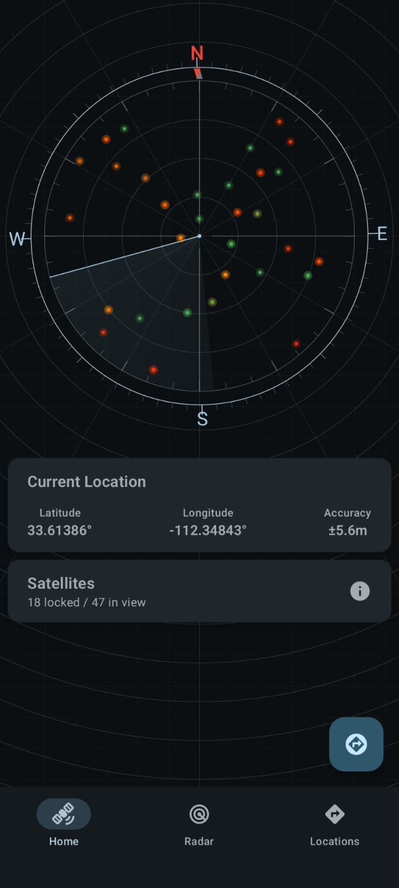
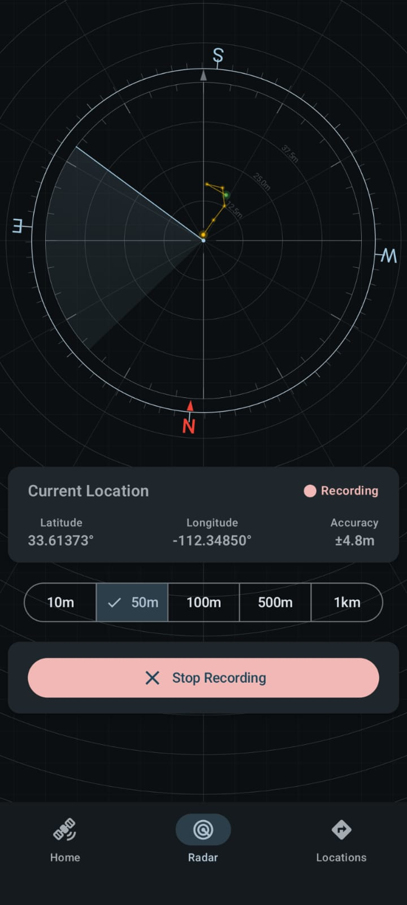
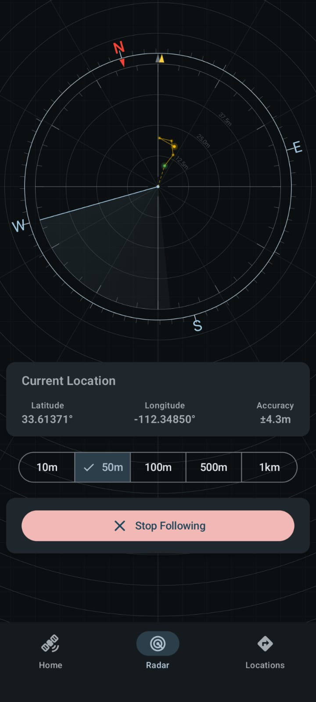
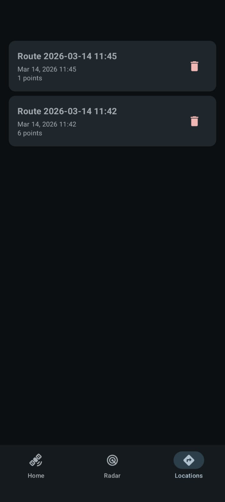

# Radar - GPS Route Tracking App

Radar is an Android application for recording GPS points to create routes, saving them locally, and navigating back along those routes.
Designed for outdoor use where traditional navigation (Google/Apple Maps) is unavailable due to poor cellular reception.

## Features

- **Route Recording** - Capture GPS points as you move
- **Route Saving** - Store routes locally for later use
- **Route Following** - Navigate back along saved routes
- **GPX Export** - Export routes as GPX 1.1 files
- **Compass Heading** - Uses device accelerometer + magnetometer
- **GPS Satellite Tracking** - See satellite visibility
- **Picture-in-Picture Mode** - Keeps radar visible while multitasking
- **Works Fully Offline** - GPS only, no internet required

## Screenshots

<div align="center">
  
  
  
  
</div>

## Technical Details

| Aspect | Value |
|--------|-------|
| **Minimum SDK** | 35 (Android 15) |
| **Target SDK** | 36 (Android 16) |
| **Language** | Kotlin |
| **Build System** | Gradle with Kotlin DSL |
| **Architecture** | MVVM with Manual Dependency Injection |
| **UI Framework** | Jetpack Compose |
| **Database** | Room |
| **Location Services** | Google Play Services Location |

## Project Structure

```
Radar/
├── app/
│   ├── src/
│   │   ├── main/
│   │   │   ├── java/com/ameraldo/radar/
│   │   │   │   ├── MainActivity     # Main activity, service binding, PiP mode
│   │   │   │   ├── navigation/      # AppDestinations (top-level tabs)
│   │   │   │   ├── service/         # LocationService (foreground service)
│   │   │   │   ├── viewmodel/       # ViewModels (Location, Route, Sensor, Settings, UIState)
│   │   │   │   ├── data/            # Room database, DAOs, entities, DataStore
│   │   │   │   ├── ui/              # Compose UI (RadarApp, screens, components, theme)
│   │   │   │   └── utils/           # Utilities (LocationUtils, GpxUtils, DistanceFormatter)
│   │   │   ├── res/                 # Android resources
│   │   │   └── AndroidManifest.xml
│   │   ├── test/                    # Unit tests
│   │   └── androidTest/             # Instrumented tests
│   └── build.gradle.kts
├── docs/                            # This documentation
├── build.gradle.kts                 # Project-level build config
├── settings.gradle.kts
└── README.md
```

## Documentation

### Architecture

- [Architecture Overview](architecture/overview.md) - System architecture and component design
- [Data Flow](architecture/data-flow.md) - Data flow between layers

### API Reference

**Services**
- [LocationService](api/LocationService.md) - Foreground service for GPS tracking
- [MainActivity](api/MainActivity.md) - Main activity, service binding, PiP mode

**ViewModels**
- [LocationViewModel](api/LocationViewModel.md) - Location state management
- [RouteViewModel](api/RouteViewModel.md) - Route management
- [SensorViewModel](api/SensorViewModel.md) - Compass/sensor handling
- [SettingsViewModel](api/SettingsViewModel.md) - App settings
- [UIStateViewModel](api/UIStateViewModel.md) - UI state (navigation, PiP)

**Data Layer**
- [AppDatabase](api/AppDatabase.md) - Room database singleton
- [RouteDao](api/RouteDao.md) - Database DAO
- [AppSettings](api/AppSettings.md) - DataStore preferences
- [ServiceState](api/ServiceState.md) - Service state persistence
- [RouteEntity](api/RouteEntity.md) - Database entities
- [LocationState](api/LocationState.md) - Location data model
- [SatelliteBlip](api/SatelliteBlip.md) - Satellite data model
- [LocationError](api/LocationError.md) - Error types
- [DistanceUnits](api/DistanceUnits.md) - Unit systems and setting defaults
- [DistanceFormatter](api/DistanceFormatter.md) - Distance label formatting
- [LocationUtils](api/LocationUtils.md) - Polar coordinate conversion
- [GpxUtils](api/GpxUtils.md) - GPX file generation

**Components**
- [RadarView](api/RadarView.md) - Canvas radar visualization
- [RangeSelector](api/RangeSelector.md) - Radar range selector
- [RouteCard](api/RouteCard.md) - Route controls
- [CurrentLocationCard](api/CurrentLocationCard.md) - Location display
- [SatellitesList](api/SatellitesList.md) - Satellite details
- [RoutesList](api/RoutesList.md) - Route list
- [ConfirmationDialog](api/ConfirmationDialog.md) - Reusable dialog

**Navigation & App UI**
- [AppDestinations](navigation/AppDestinations.md) - Top-level navigation destinations
- [RadarApp](ui/RadarApp.md) - Root composable, permissions, PiP, screen wiring

### Screens

- [Home Screen](screens/home.md) - Recording controls, satellite info
- [Radar Screen](screens/radar.md) - Map visualization, navigation
- [Routes Screen](screens/routes.md) - Saved routes management
- [Settings Screen](screens/settings.md) - App configuration

### Guides

- [Setup Guide](guides/setup.md) - Development environment setup
- [Build Instructions](guides/build.md) - Building the app
- [Testing Guide](guides/testing.md) - Running tests

## Permissions

The app declares the following permissions in `AndroidManifest.xml`:

**Runtime permissions (requested from the user):**
- `ACCESS_FINE_LOCATION` - GPS location for recording and following
- `ACCESS_COARSE_LOCATION` - Approximate location
- `POST_NOTIFICATIONS` - Foreground-service notification

**Normal permissions (granted at install):**
- `FOREGROUND_SERVICE` - Declared for the location foreground service
- `FOREGROUND_SERVICE_LOCATION` - Declares the foreground service type as location
- `WAKE_LOCK` - Declared for wake-lock capability (no wake lock is currently acquired in code)

**Special permission:**
- `REQUEST_IGNORE_BATTERY_OPTIMIZATIONS` - Declared to allow requesting a battery-optimization exemption (not currently requested at runtime)

These are required for the location-based features of the application. This app works entirely offline using only GPS - no internet or cellular connection required.

## License

This project is licensed under the GPL License - see the [LICENSE.md](../LICENSE.md) file for details.
